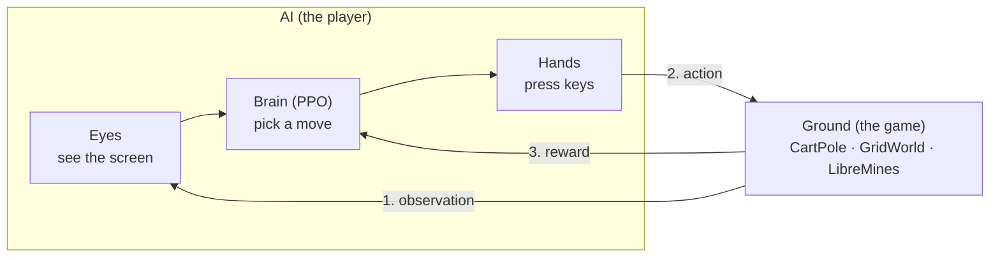

# GameTrainer

[](https://github.com/Showerss/GameTrainer/actions/workflows/tests.yml)
[](LICENSE)

**GameTrainer teaches a computer to play games by trial and error, and makes swapping the game a one-line config change.**

It can play a built-in physics game, a grid game we wrote, and a real desktop Minesweeper app, pressing real keys and reading the real screen. The learning algorithm is borrowed. What this project builds is the **plumbing**: a clean, standard plug between *any* game and *any* learner.

## How it works



Every game follows one standard, **Gymnasium**: two methods, `reset()` and `step()`. If a game keeps that promise, any learner can play it. [More in concepts.md →](docs/concepts.md)

## What it has proven

| Milestone | Proven | Result |
| :--- | :--- | :--- |
| M1 | A borrowed learner (PPO) learns CartPole | 22 → **500** (max score) |
| M2 | It learns a game we built | **+0.93** vs random −0.09 |
| M3 | It learns from **pictures only** | **+0.98**, goal 100% |
| M4 | Swapping games needs **zero code edits** | 3 games, 1 runner |
| M5 | It drives a **real desktop app** with real keys | 4/4 checks, macOS + Windows |

Every number, with its baseline, hardware and time: [**RESULTS.md**](docs/RESULTS.md).

## Quickstart

```bash
git clone https://github.com/Showerss/GameTrainer.git
cd GameTrainer
python -m venv .venv
.venv\Scripts\Activate.ps1        # Windows
source .venv/bin/activate         # macOS / Linux
pip install -e ".[rl]"
```

| To... | Run |
| :--- | :--- |
| Open the menu | `python main.py` |
| Run the tests (~6 s) | `pytest` |
| Check code style | `ruff check .` |
| Train any game from a profile | `python scripts/train_from_profile.py --profile profiles/gridworld.yaml` |
| Watch it drive Minesweeper | open LibreMines (v2.3.0, Easy 8×8), then `python scripts/check_hands.py` |

## Docs

Start at [**docs/README.md**](docs/README.md). It lists every doc and the order to read them in.

| Want to... | Read |
| :--- | :--- |
| Understand the ideas | [concepts.md](docs/concepts.md) |
| See how the code is organised | [architecture.md](docs/architecture.md) · [diagrams](docs/UML_FULL.md) |
| Know why it was built this way | [decision records](docs/adr/README.md) |
| See the plan | [PRD.md](docs/PRD.md) |

## Built with

Python · [Gymnasium](https://gymnasium.farama.org/) · [stable-baselines3](https://stable-baselines3.readthedocs.io/) (PPO) · [timm](https://github.com/huggingface/pytorch-image-models) (ViT) · PyTorch · OpenCV · mss

## License

[MIT](LICENSE). Use it, change it, share it; just keep the copyright notice.
