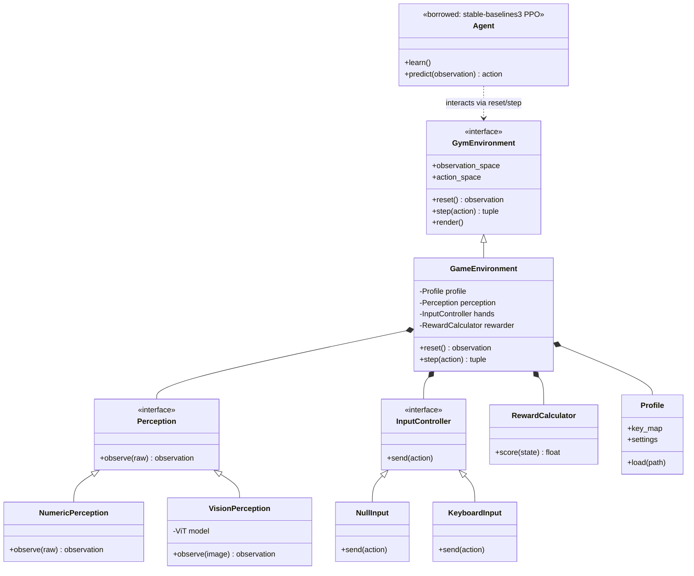

# GameTrainer - PRD v2

> **Covers:** what gets built, and in what order - the milestone plan, scope, and
> the architecture this project is proving out.
> **Status:** current. **Last verified:** 2026-10-04 (M5 closed and verified PASS
> live on both macOS and Windows; all 8 bricks complete; updated cross-references to unified docs).
> **Authority:** this file wins on *what* gets built and in what order.
> `docs/DOC_STANDARD.md` wins on *how* docs are written.

> A system that teaches an AI to play games by watching the screen and learning by trial and error.
> **The real point of this project is the architecture:** a clean, swappable link between *any* game world and *any* AI brain.

---

## 1. The one-paragraph pitch

GameTrainer connects a **game** to an **AI** through a **standard link**, so the AI can learn to play by looking at the screen, taking actions, and getting a score. We are not trying to invent a new AI. We are building the *plumbing* - the part that lets any game and any brain snap together - and proving it works by starting tiny and scaling up.

---

## 2. The mental model (read this before anything else)

Three big parts:

| Part | What it is | Its job |
| :--- | :--- | :--- |
| **Ground** | The game world | 1) Show what's happening (**observation**) &nbsp; 2) Grade the AI (**reward**) |
| **AI** | The player | Look, decide, act |
| **Link** | The Gymnasium API | The standard socket both plug into |

The **AI** is itself three pieces:

- **Eyes** – a Vision Transformer (ViT) or CV tile classifier. *Only sees.* Turns pixels into a summary.
- **Brain** – PPO (from stable-baselines3). *Only decides.* Learns what's good.
- **Hands** – a Python/native input layer. *Only acts.* Presses keys.

The whole thing is one tiny loop, forever:

```
observe ➔ act ➔ reward ➔ repeat
```

**What we build vs. borrow:**

- 🔨 **We build:** the Ground (game worlds) and the Link (the socket + profiles).
- 📦 **We borrow:** the Brain (PPO) and the Eyes backbone (a pretrained ViT).

---

## 3. Scope - the crawl-first plan

We do **NOT** start on Stardew Valley. It has no clear score and messy rewards. We earn our way up:

1. **CartPole** (built-in game) ➔ prove the link + borrowed brain work. *Build nothing.*
2. **Tiny GridWorld** (our own game) ➔ prove we can author a Ground with its own reward.
3. **Add the Eyes** ➔ make the agent learn from a *picture* of the grid instead of from numbers.
4. **Make it swappable** ➔ prove switching games is config-only.
5. **Add the Hands** ➔ drive a real, simple game window with real key-presses (**VERIFIED LIVE**).
6. **Stardew (stretch / later)** ➔ it becomes *just another profile*.

**Non-goals (on purpose, for now):**

- ❌ No control discovery - controls are hard-typed in a profile. (Discovering them is two hard problems stacked; skip it.)
- ❌ No memory reading / process injection.
- ❌ No C++ in v1. Python hands are fast enough to start.
- ❌ No cloud / paid APIs. Local only.

---

## 4. Architecture - components & the contract

Everything hangs off **one contract**: the Gymnasium environment interface.

```python
# Every "Ground" MUST look like this. This is the socket.
observation, info = env.reset()
observation, reward, terminated, truncated, info = env.step(action)
# terminated = the episode ended naturally (goal reached / pole fell)
# truncated  = the episode was cut short (e.g. ran out of time)
```

If a Ground obeys that, **any** brain can plug in. That swappability *is* the architecture flex.

- **`GameEnvironment`** - wraps a game. Holds a **Perception** (eyes), an **InputController** (hands), a **RewardCalculator**, and a **Profile**.
- **`Perception`** - swappable. `NumericPerception` early on; `VisionPerception` (ViT / CV) later.
- **`InputController`** - swappable. `NullInput` (programmatic, for CartPole/GridWorld); `KeyboardInput` (SendInput/Quartz, for real games).
- **`RewardCalculator`** - turns game state into a score.
- **`Profile`** - loads `profile.yaml` (key mappings, settings). Adding a new game = adding a profile.
- **`Agent`** - *borrowed*. PPO from stable-baselines3. We don't write this.

---

## 5. UML class diagram

> **Correction - 2026-08-14 (M4 closed).** The diagram below was the original
> composition idea: a `GameEnvironment` class holding a `Perception`, an
> `InputController`, a `RewardCalculator`, and a `Profile`. **M4 did not build
> it this way.** There is no `GameEnvironment` wrapper class - `GridWorldEnv`
> does the eyes/hands/scorecard job directly, and `make_env(profile)`
> (`src/gametrainer/factory.py`) is the only place a `Profile`'s name becomes an
> object: one function, one `if`-chain, not a class hierarchy. `RewardCalculator`
> and `Profile` themselves *were* built close to as shown here. Kept as the
> historical design intent, not deleted, per `docs/DOC_STANDARD.md` rule 4 - see
> `docs/m4/M4_ToDo.md` ("the design") and `docs/m4/backpack_diagram.png` for the
> full comparison.
>
> **For the live, implemented system class diagrams, sequence flows, and layered C4 architecture models across M0-M5, see [`docs/UML_FULL.md`](UML_FULL.md).**



---

## 6. Suggested libraries (imports)

```python
# The Link
import gymnasium as gym

# The Brain (borrowed)
from stable_baselines3 import PPO

# Math / arrays
import numpy as np

# Config
import yaml
from dataclasses import dataclass

# The Eyes (borrowed backbone, M3)
import torch
import timm

# The Hands (M5 - built, Win32 + Quartz via Python ctypes)
import ctypes
# Optional C++ extension (src/cpp/clib.cpp) remains available for v2
```

---

## 7. SMART timeline (light pace - a few hours/week)

Each milestone has **one job** and a clear test to prove it works.

| # | Milestone | Time | Done when... | Status |
| :--- | :--- | :--- | :--- | :--- |
| **M0** | Setup | 1-2 wks | CartPole runs 100 random steps, no crash | ✅ PASS |
| **M1** | Borrow the Brain | 2-3 wks | PPO trains on CartPole, clearly beats random | ✅ PASS |
| **M2** | Build our own Ground | 2-3 wks | Tiny GridWorld runs with PPO, reaches goal | ✅ PASS |
| **M3** | Add the Eyes | 3-4 wks | GridWorld trains from ViT pixel input on CPU | ✅ PASS |
| **M4** | Make it swappable | 2-3 wks | Swap CartPole/GridWorld via YAML, 0 code changes | ✅ PASS |
| **M5** | Add the Hands | 3-4 wks | Drive real game window (LibreMines) live | ✅ PASS |
| **M6** | Stardew (stretch) | 4-6 wks | Run on real game as "just another profile" | ⏳ NEXT |

**Total estimated:** ~4-6 months at light pace. (M0–M5 complete).

### 7.1 Future milestones (v2+ / post-M6 roadmap)

Items that are intentionally out of scope for v1:

- **M7: Linux live hands backend (`uinput` / `X11` / `Wayland`).** M5 shipped Win32 `SendInput` and macOS `Quartz`. Linux completes the OS trio.
- **M8: Opt-in C++ input extension (`src/cpp/clib.cpp`).** Python `ctypes` handles M5 cleanly. Compiling the C++ extension provides sub-millisecond input latency for action-heavy titles.
- **M9: Multi-game concurrent training.** Vectorized environments across multiple physical display targets.

### 7.2 R1 — Cleanup & OOP pass (post-M5)

Not a milestone: no new features, no PASS bar moves. Shorter code, OOP where it earns its keep, same behaviour.
Plan: 13 bricks (audit findings #1–#18).

**Done when:** `pytest` and `ruff check .` pass, every experiment that passed before still prints PASS, the Gymnasium `reset()`/`step()` contract is unchanged, and `docs/UML_FULL.md` matches the code.

- **Brick 1 — two real bugs (2026-10-17).** `main.py` checked for `pydantic`/`pynput`/`typing_extensions`, which nothing uses and `setup.py` never installs, so a fresh machine would report them "missing" forever. The list now matches `install_requires`, and the dead `train`/`play` modes fold into "unknown mode → usage, exit 1". `train_from_profile.py`'s settings printout skipped the three Minesweeper reward numbers (DOC_STANDARD rule 3). It now loops over the Profile's own fields, so it can't skip one again. Verify: `python main.py bogus` prints usage and exits 1, and the profile printout lists `safe_reveal_reward`/`mine_penalty`/`win_reward`. `pytest` (without `test_m4_verdict.py`, since SB3 isn't installed on this machine): 139 passed, 9 skipped, same as before.
- **Brick 2 — the hands get a real abstract base (2026-10-17).** `InputController` is now an `abc.ABC` with `tap_key`/`tap_chord` as `@abstractmethod`. Before, it faked this by raising `NotImplementedError` when a method was *called*. Now Python refuses to *build* a hands object that's missing either method, and the error names the missing ones. Removed the empty `__init__` (plus the `super().__init__()` call to it) and NullInput's four redundant `pass` moves, which the parent already covers. Verify: `InputController()` raises `TypeError` naming both methods, NullInput's moves still run, and `pytest` gives 139 passed, 9 skipped.
- **Brick 3 — GridWorld gets a move table and public handles (2026-10-17).** `step()` reads a `MOVES` table (action → row/col change) and clamps to the grid, in place of a 4-branch `if/elif`. Action checking moved into one helper, `_to_action_int`, with the same `invalid action: …` errors. `RandomStart` no longer reaches into GridWorld's private parts: it sets the new `goal` attribute and calls the new `place_agent(row, col)`. Also dropped the empty `close()` and shortened the text render. Three test lines in `test_random_start.py` now read `goal` instead of `GOAL`. Verify: `pytest` gives 139 passed, 9 skipped, and bad actions (`True`, `1.5`, NaN, `4`, `None`) are still rejected.
- **Brick 4 — Minesweeper env, rewards and vision lose their copy-paste (2026-10-17).** `MinesweeperEnv.step` looks up the hands method in a dispatch table (`hand_for_action[action]()`) in place of a 6-branch `if/elif`, and a `_pause()` helper replaces the delay check that was written twice. `rewards.py` gets `_revealed_safe(grid)`, which replaces the "is this a revealed safe cell" mask written 3 times. `minesweeper_vision.py` gets one `_BACKGROUNDS` table (it replaces two dicts that had to agree) and one `_colour_distance(a, b)` helper, which replaces the same maths written 4 times. Docstrings now list MINE. Verify: `pytest` gives 139 passed, 9 skipped, and all the PNG-fixture vision tests pass.
- **Brick 5 — Profile does its own work (2026-10-17).** New method `Profile.ppo_settings()` returns the 8 PPO numbers as a dict, so the training script calls `PPO(..., **profile.ppo_settings())` instead of copying fields one at a time. Inside `from_yaml`, a `_FIELDS_FOR_REWARD` table replaces two near-identical "reward X requires fields" blocks, and a `_require_positive` helper replaces two copies of the "> 0" check. Error text is unchanged. Added one test: `ppo_settings()` returns every PPO number from the YAML, because a dropped setting would silently fall back to PPO's default. Verify: `pytest` gives 140 passed, 9 skipped, and all 4 profiles load. Still owed: a `--smoke` run once `.[rl]` is installed.
- **Brick 6 — the referee moves into the package (2026-10-17).** New `src/gametrainer/referee.py` holds `check_contract_shapes`, `measure_random_baseline`, `evaluate_greedy`, `decide_verdict` and a new `pass_or_fail` helper. All were moved unchanged from `train_from_profile.py`, which keeps only the M4-only `source_fingerprint`. `train_gridworld_vit.py` no longer imports from another script, and its own copy of the greedy-eval loop is gone. Its bar numbers (80% goal rate, +0.40 margin) did not move. The referee has no imports, so tests can load it cheaply. Verify: `pytest` gives 140 passed, 9 skipped; the 11 `test_m4_verdict` tests pass with SB3 stubbed; a fake down-then-right model scores 0.93 in 8 steps on GridWorld. Still owed: `--smoke` runs once `.[rl]` is installed.
- **Brick 7 — M1/M2 share their training setup (2026-10-17).** New `src/gametrainer/training.py` holds `CLASSIC_PPO_SETTINGS`, `make_training_callbacks()` and `best_eval_reward()`. Before, `train_cartpole.py` and `train_gridworld.py` spelled these out line for line. Both scripts now use them plus the referee's `evaluate_greedy`, which removes M2's own eval loop and M1's hand-written VecEnv fallback (104 lines gone). Bars, baselines and verdict text are unchanged. Verify, on an AMD Ryzen 7 9700X (CPU only, torch 2.14.1+cpu): `pytest` gives 163 passed, 0 skipped. `train_cartpole.py` **PASS**: best mean 500.0 vs bar ≥44 (baseline ~22), 21 s wall-clock. `train_gridworld.py` **PASS**: best mean +0.93 vs bar ≥+0.50 (baseline ~−0.30), 20/20 goals in 8 steps, 15 s wall-clock. The `--smoke` runs owed from Bricks 5–6 (cartpole, gridworld, gridworld_pixels) all run end to end with no errors; their FAIL verdicts are expected at 200 steps.
- **Brick 8 — the TUI menu becomes one table (2026-10-17).** Every main-menu option is now one `MenuItem` row in `MENU_ITEMS`. A row either launches a `script` or opens a `screen` (profile picker, changelog, pip, quit). The menu text, the allowed choices and the dispatch are all generated from that list, so an option's number is its position and can't drift. Before, each option lived in 3 places that had to agree (`_menu()` text, a `TuiConfig` path field and an `if choice == N` block, repeated 7 times). The profile submenu is built the same way from `PROFILES`. `TuiConfig` shrank to `project_name` and `changelog_relpath`. Not unit-tested on purpose: it's menu wiring (CLAUDE.md §5). Verify: `python main.py`. A piped session (changelog → profiles → Back → pip → Back → Quit) exits 0, and option 3 launches `run_gridworld.py`. `pytest` gives 163 passed.
- **Brick 9 — check_hands sends one sequence, by construction (2026-10-17).** The Control 1 key sequence now lives once, in `TARGET_SEQUENCE` (with `TARGET_CELL`). Control 1 sends it to the real hands and Control 2 sends the *same tuple* to NullInput through `_press()`, so the negative control can't drift from the positive one. Before, each copied the sequence out by hand. `_cells_changed()` replaces the cell-diff maths written 4 times, the verdict word comes from `referee.pass_or_fail`, the dead `NotImplementedError` branch is gone, and the stale "prints NOT RUN today" docstring is fixed. Bar numbers are unchanged. Verify: `pytest tests/test_check_hands.py` gives 7 passed, and a recording fake hands object receives S, S, D, D, P. Still owed: a live `check_hands.py` run with LibreMines open (4/4 PASS).
- **Brick 10 — ViT extractor tidy-up (2026-10-17).** The ImageNet mean/std tensors are now built once in `__init__` as buffers (`register_buffer(..., persistent=False)`) instead of on every frame in `forward()`. They move to the GPU with the model, and they stay out of saved files, so older models still load. Also removed the duplicate `self._features_dim` (the SB3 base class already stores it) and the unused `trainable = 0`, and the timm `ImportError` now chains its cause with `from err`. Verify: a saved pixels model gives identical features before and after on 10 fixed pictures (max difference 0.0); `pytest` gives 163 passed (4 ViT tests); the `gridworld_pixels --smoke` run trains end to end with no errors (FAIL verdict expected at 200 steps).
- **Brick 11 — the hands split into one class per OS (2026-10-17).** `KeyboardInput` is now an abstract base holding only what both OSes share: `hwnd`, the `focus()` ask-then-confirm loop and `_require_focus()`. The per-OS work lives in `WindowsKeyboardInput` (SendInput, AttachThreadInput) and `MacKeyboardInput` (Quartz, NSRunningApplication), each providing `has_focus`, `_bring_to_front`, `tap_key` and `tap_chord`. `keyboard_for_this_os(hwnd)` is now the one place that asks "which OS?". Before, every method asked it again with an `if darwin / else`. Structs, the import-time size check, keycode tables and every Teacher Note were kept. `factory.py` and `check_hands.py` call the picker, and `test_make_env` patches it. Verify: `pytest` gives 163 passed; on Windows the picker returns `WindowsKeyboardInput`, `KeyboardInput(1)` raises `TypeError` naming 4 methods, and a bogus window refuses `focus()`/`move_down()` with nothing typed. Still owed: live `check_hands.py` 4/4 on Windows **and** macOS.
- **Brick 12 — the screen splits into one class per OS (2026-10-17).** `GameWindow` is now an abstract base holding what both OSes share (`hwnd`, `grab()`, `close()`, `with` support). `WindowsGameWindow` and `MacGameWindow` each provide `_find(title)` and `rect`, and `game_window_for_this_os(title)` is the one place that asks "which OS?". The free functions `find_window`/`window_rect` were folded into those classes (nothing else called them). The Windows half now declares `argtypes` for all 8 user32 calls, so 64-bit window handles can't be silently truncated (audit #6). The `except Exception: pass` around the desktop-attach calls was removed, not narrowed: those calls signal failure by returning 0, so the only thing it could catch was a real bug. `factory.py`, `check_hands.py` and `test_make_env` use the picker. The DPI call at import is unchanged. Verify: `pytest` gives 163 passed; on Windows the picker finds "Program Manager" by title and grabs a real 3640×1920 frame; a missing game raises the same `WindowNotFound` text. Still owed: live `check_hands.py` 4/4 on Windows and macOS (also covers Brick 11), plus `minesweeper.yaml --smoke` with the game open.
- **Brick 13 — the UML catches up with the code (2026-10-17).** Updated `docs/UML_FULL.md`: §3.2 and §4.1 show the new `referee.py`/`training.py` modules and the per-OS pickers. The §5.1 class diagram adds the Windows/Mac hands and screen subclasses (abstract methods marked `*`), `MinesweeperAction`, `CellState`, the 4 exception classes, `Measurements`/`ControlResult`, `Logger`, `GridWorldEnv.goal`/`place_agent()` and `Profile.ppo_settings()`. It drops the `escape()` method that never existed, and it fixes the RandomStart arrow (pixels path only, not "robust training"). §5.2/5.3 use the pickers, and §6 adds R1 to the roadmap. Also fixed §4.1, which was already broken before R1: it used class-diagram arrows (`*--`, `<|--`) inside a flowchart, so it never rendered. They are now labelled flowchart arrows. Verify: all 50 code names in the diagrams exist in `src/` or `scripts/` (grep), and the Mermaid parser accepts 10/10 diagrams (the committed version: 9/10).
- **R1 final verification — M3 ViT full run (2026-10-17).** `train_gridworld_vit.py` (20,000 steps, frozen ViT-Tiny, run on Bricks 6/10's shared referee and buffered extractor) **PASS**: trained mean +0.98 vs live random baseline +0.34 (bar ≥ +0.74), goal reached in 100% of 20 greedy episodes (bar ≥ 80%), mean 2.5 steps (perfect ≈ 2.5), contract shapes unchanged. Hardware: AMD Ryzen 7 9700X, CPU only (torch 2.14.1+cpu). Wall-clock: 14.2 min training, 14.3 min total. Still owed for R1: live `check_hands.py` 4/4 on Windows and macOS, and `ruff check .`.
- **R1 final verification — live hands on Windows (2026-10-17).** `check_hands.py` against LibreMines v2.3.0 (windows-qt6, re-downloaded from the official GitHub release; SHA-256 matched), Easy 8×8, normal (un-maximised) window: **PASS 4/4** in 25 s. Control 1 changed exactly 1 cell, the target (1, 2). Control 2 (NullInput, same `TARGET_SEQUENCE`) changed 0 cells. Control 3: live 1, frozen 0. Control 4: 20/20 clean resets, 0 mouse clicks. This covers Bricks 9, 11 and 12 on real hardware.
- **Found during verification, not caused by R1 (2026-10-17): maximised window breaks `find_board`.** When LibreMines is maximised, Windows reports its rect 8 px outside the screen (`-8, -8`). Those strips capture as pure black, merge with a board that touches the left edge, and the resulting dark block is not square, so `BoardNotFound` is raised. Confirmed by trimming the 8 px border: the board was then found and all 64 cells read correctly. The pre-R1 `window_rect` used the same `GetWindowRect`, so this is an existing gap. Workaround: keep the window un-maximised. Proposed follow-up (its own brick, after R1): measure the visible frame with `DwmGetWindowAttribute(DWMWA_EXTENDED_FRAME_BOUNDS)`.
- **Follow-up in progress — capture the window's visible frame (2026-10-17, kept by Phillip, not yet verified as the fix).** `WindowsGameWindow.rect` now asks DWM for `DWMWA_EXTENDED_FRAME_BOUNDS` instead of `GetWindowRect`, so the capture is exactly the window you can see, without Windows' invisible ~8 px resize border. Measured on the live game: 8 px in from `GetWindowRect` on every side, and exactly the monitor's area when maximised. A maximised Easy board on the right-hand monitor reads correctly with it; `pytest` gives 163 passed and `ruff` is clean. **Not yet proven:** that this fixes the failure above. The "black strip merges with the board" explanation did not hold up: adding a pure-black 8 px border to a good capture still finds the board. On the right-hand monitor the old box also worked. Next step: reproduce at full resolution with LibreMines maximised on the main monitor, compare old and new boxes, then run `check_hands.py` maximised.
- **R1 final verification — ruff clean (2026-10-17).** `ruff check .` (ruff 0.17.1) went from 16 findings at the last commit to 13 after R1 (R1 added none, removed 3) to **0**. All 13 remaining were already there before R1, and were fixed at Phillip's request. Ruff's safe auto-fixes (sorted imports in `main.py`/`train_gridworld_vit.py`, an unused `FLAGGED` import, a dead `# noqa`). `GameWindow.__enter__` returns `Self`, imported under `TYPE_CHECKING` so Python 3.9 still runs. Six unused test variables now start with `_`, and one nested `with` was merged. The two "is it frozen?" tests now expect `dataclasses.FrozenInstanceError`, not any `Exception`, so they can no longer pass on an unrelated error. Verify: `ruff check .` gives "All checks passed!" and `pytest` gives 163 passed. Only the live macOS `check_hands.py` run is still owed for R1.

---

## 8. Risks & honest notes

- **Stardew has no score.** We will have to define one (money earned, time survived, crops harvested). *That's why it's last.*
- **ViT can be slow on CPU.** Keep images small (224x224), batch size low, freeze the backbone.
- **PPO is tricky to tune.** Don't tweak hyperparameters until everything else works. Use defaults first.
- **Window focus & key-presses can be flaky.**
  > **Note - 2026-09-10 (corrected in place per DOC_STANDARD rule 4).** An earlier
  > draft of this section noted: *"M5 initially targeted Windows SendInput; macOS /
  > Linux will need their own input layers later."* That note is obsolete. On
  > 2026-09-07 (M5 Brick 7), a live macOS backend was built and proved - `GameWindow`
  > via `Quartz.CGWindowListCopyWindowInfo`, `KeyboardInput` via
  > `CGEventCreateKeyboardEvent`/`CGEventPost` - and `check_hands.py` PASSed all
  > four controls live on macOS. Live hands are **Windows + macOS**, not
  > Windows-only; Linux remains the open item, still tracked as Future Milestone
  > M7 in § 7.1. Kept in place rather than rewritten, per DOC_STANDARD rule 4.

---

## 9. For the AI coding assistant

Build in milestone order (M0 ➔ M6). Do **not** scaffold later phases early. After each milestone, stop and confirm the "Done when." check passes before continuing. Keep the Gymnasium contract (`reset`, `step`) untouched across every environment.

---

## 10. Glossary (the words to know)

Learn these five first - everything else hangs off them:

| Term | Plain meaning | In our metaphor |
| :--- | :--- | :--- |
| **Environment** | The game, in code | The **Ground** |
| **Agent** | The AI that plays | The **AI** |
| **Observation** | What the game shows the AI | "Here's the screen" |
| **Action** | What the AI does | "Press right" |
| **Reward** | The score the game gives back | "Good: +1" |

For everything else - Gymnasium's API, RL vocabulary, PPO - the full reference
lives in one place: [`docs/MASTER_GUIDE.md`](MASTER_GUIDE.md) § 4.
