# GameTrainer - Full Architecture & UML Diagrams

> **Covers:** the complete architectural model and visual diagrams of GameTrainer -
> hierarchical C4 layers (Context, Containers, Components, Code workflows),
> class hierarchy, execution sequences, and milestone roadmap.
> **Status:** current.
> **Last verified:** 2026-10-17, R1 Brick 14. Every class, field and arrow was re-checked line by line against `src/` and `scripts/`. §5.1 was split into five layer diagrams; composition and aggregation were corrected; §3.2, §4.1 and §5.3 were fixed (see the correction note at the end of §5.1).
> Earlier: 2026-10-17, R1 Brick 13 (per-OS hands and screen classes, shared `referee`/`training` modules). 2026-10-04 (unified C4 layered models and UML diagrams into a single architectural authority).
> **Authority:** this file owns all *diagrams* and architectural relationships across
> all milestones. For the same structure in words, see [`architecture.md`](architecture.md); for numbers, [`RESULTS.md`](RESULTS.md);
> for project requirements and milestone scopes, see [`docs/PRD.md`](PRD.md).
> Written to `docs/DOC_STANDARD.md`.

> Every diagram here is rendered with **Mermaid** - GitHub, VS Code (with Markdown Preview Mermaid Support),
> and standard Markdown previewers render them natively.
>
> **Legend used throughout:**
> - **Solid arrow `-->` / `..>`** - "uses / calls / depends on"
> - **Hollow triangle `<|--`** - "is a kind of" (inheritance)
> - **Filled diamond `*--`** - "builds its own one and controls its life" (composition)
> - **Hollow diamond `o--`** - "is handed one from outside" (aggregation)

---

## 1. Introduction: The C4 Abstraction Hierarchy

To understand GameTrainer, we zoom in progressively through four levels of abstraction:

```
Level 1: System Context  --> Who uses GameTrainer and what external systems does it touch?
Level 2: Containers      --> What are the high-level apps, runners, and storage units?
Level 3: Components      --> What internal modules make up the gametrainer core engine?
Level 4: Code & Classes  --> How do classes, methods, and workflows execute in real-time?
```

---

## 2. Level 1: System Context & The Universal Loop

### 2.1 The Universal Loop (The Whole Project in One Picture)

Everything else is detail. This is the system:

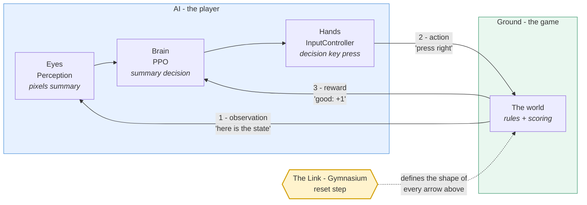

**Read it as:** the game shows a state  the eyes summarise it  the brain picks a move  the hands perform it  the game scores it  repeat, thousands of times. The Link (Gymnasium) is the contract that makes every arrow a standard shape.

### 2.2 System Context Diagram

The bird's-eye view showing how GameTrainer interacts with human engineers, external games, the host OS, and borrowed ML libraries:

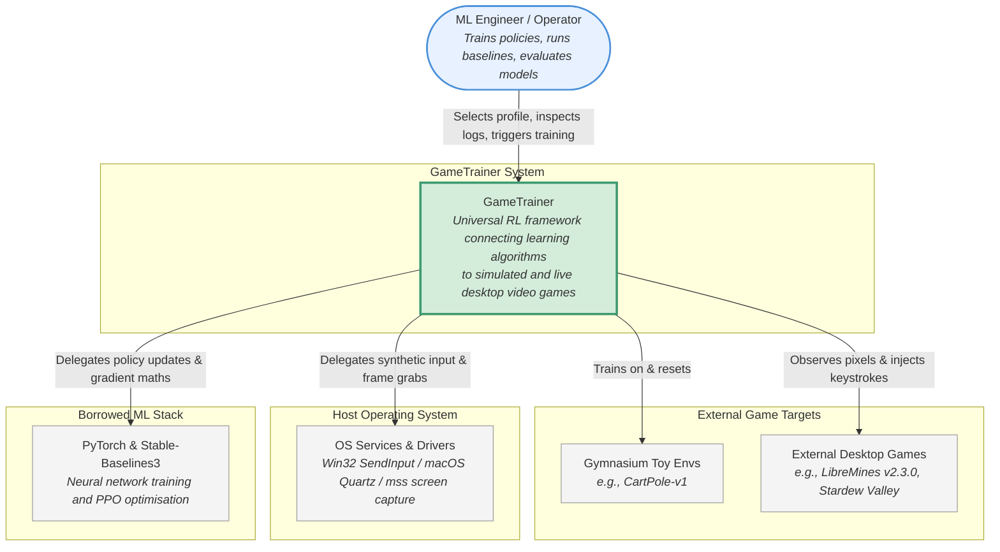

### 2.3 Build vs. Borrow (Our Work vs. Solved Problems)

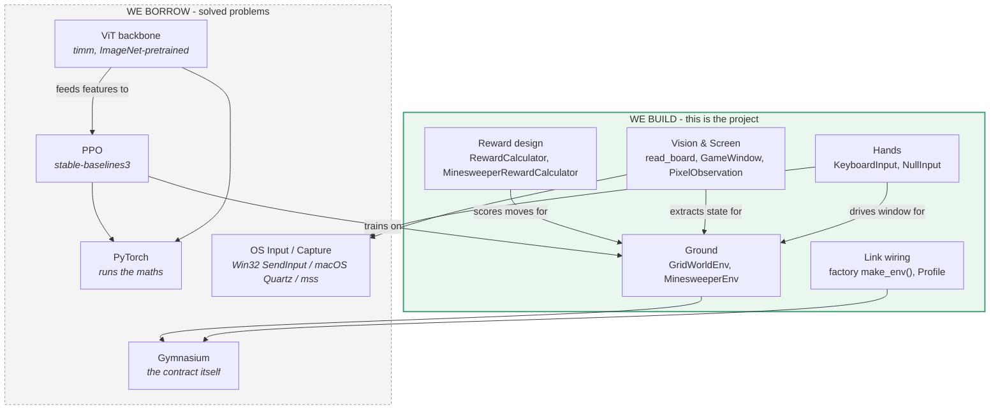

**Why this split?** Writing your own RL algorithm is months of subtle, silently wrong maths. Writing your own connector is where the actual engineering insight is.

---

## 3. Level 2: Containers & Runtime Execution

### 3.1 Container Diagram

Zooming in on the **GameTrainer System Boundary** to show deployable/runnable units, file-based configuration, and model storage:

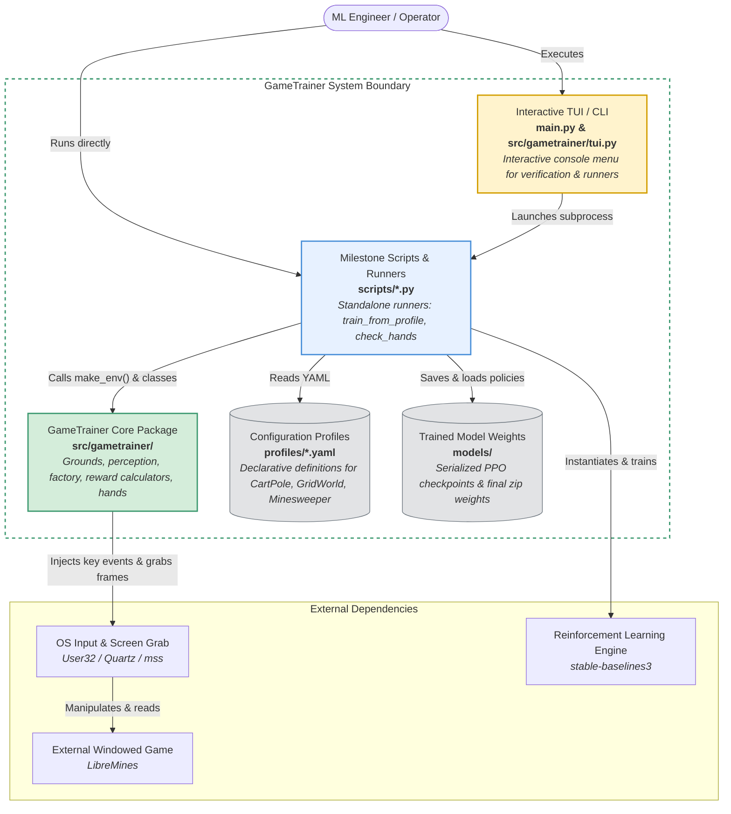

### 3.2 What Actually Runs (Runners & Entry Points)

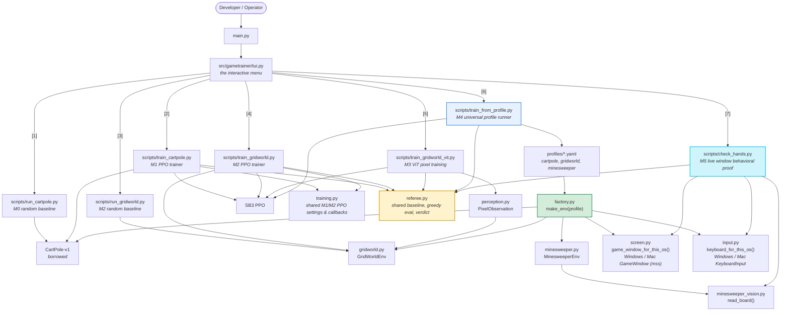

The TUI's menu numbers come from the position of each row in `MENU_ITEMS` (`tui.py`), so the `[1]`-`[7]` labels above are simply the first seven rows.

---

## 4. Level 3: Components & Architecture

### 4.1 Component Diagram

Zooming inside the **GameTrainer Core Package (`src/gametrainer/`)**. Here we see how internal modules align with the architectural roles: **The Link**, **The Ground**, **The Eyes**, **The Hands**, and **The Rewards**:

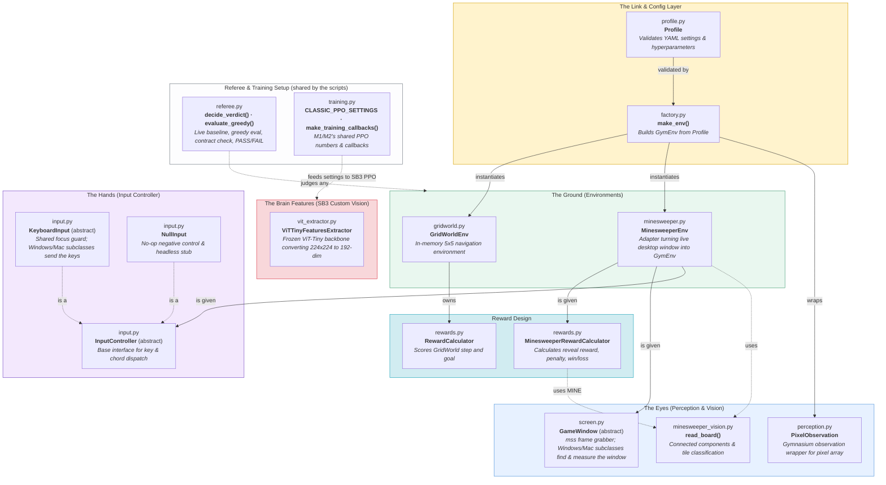

### 4.2 Component Snapshot Summary

| Component / Layer | Implementation | Status | Milestone |
| :--- | :--- | :--- | :--- |
| **Gymnasium Contract** | `gymnasium.Env` (`reset`, `step`) | Live | M0 |
| **Borrowed Brain** | `stable_baselines3.PPO` | Live | M1 |
| **Custom GridWorld Ground** | [`gridworld.py`](../src/gametrainer/gridworld.py) | Live | M2 |
| **ViT Eyes Extractor** | [`vit_extractor.py`](../src/gametrainer/vit_extractor.py) | Live | M3 |
| **Pixel Observation Wrapper** | [`perception.py`](../src/gametrainer/perception.py) | Live | M3 |
| **Profile Dataclass** | [`profile.py`](../src/gametrainer/profile.py) | Live | M4 |
| **Environment Factory** | [`factory.py`](../src/gametrainer/factory.py) | Live | M4 |
| **GridWorld Reward Calculator** | [`rewards.py`](../src/gametrainer/rewards.py) (`RewardCalculator`) | Live | M4 |
| **Universal Profile Runner** | [`train_from_profile.py`](../scripts/train_from_profile.py) | Live | M4 |
| **Swappability Referee & Proof** | [`test_m4_verdict.py`](../tests/test_m4_verdict.py) | Live | M4 |
| **Live Screen Capture** | [`screen.py`](../src/gametrainer/screen.py) (`GameWindow` → `WindowsGameWindow` / `MacGameWindow`) | Live | M5, split per OS in R1 |
| **Live Native Hands** | [`input.py`](../src/gametrainer/input.py) (`KeyboardInput` → `WindowsKeyboardInput` / `MacKeyboardInput`) | Live | M5, split per OS in R1 |
| **Connected Components CV** | [`minesweeper_vision.py`](../src/gametrainer/minesweeper_vision.py) | Live | M5 |
| **Minesweeper Reward Calculator** | [`rewards.py`](../src/gametrainer/rewards.py) (`MinesweeperRewardCalculator`) | Live | M5 |
| **Minesweeper Gymnasium Adapter** | [`minesweeper.py`](../src/gametrainer/minesweeper.py) | Live | M5 |
| **Live Behavioral Proof** | [`check_hands.py`](../scripts/check_hands.py) | Live | M5 |
| **Shared Referee** | [`referee.py`](../src/gametrainer/referee.py) | Live | R1 |
| **Shared M1/M2 Training Setup** | [`training.py`](../src/gametrainer/training.py) | Live | R1 |
| **Stardew Valley Ground** | `profiles/stardew.yaml` | Planned | M6 |

---

## 5. Level 4: Code, Classes & Detailed Workflows

### 5.1 Class Diagrams (M0-M5 + R1 live system)

The live system has about 40 classes, which is too many to read in one picture. So the class view is split into five diagrams:

| Diagram | What it shows | Read it when you want to know... |
| :--- | :--- | :--- |
| **5.1a Overview** | One box per key class, no members | "How do the layers connect?" |
| **5.1b Grounds & Link** | Envs, wrappers, Profile, factory | "What can PPO train on, and who builds it?" |
| **5.1c Eyes & Screen** | ViT extractors, board reader, window capture | "How do pixels become an observation?" |
| **5.1d Hands** | InputController family | "How does a decision become a keypress?" |
| **5.1e Scoring, Referee & Tools** | Reward calculators, referee, training setup, check_hands, TUI | "Who scores, who judges, who runs things?" |

**Arrow cheat sheet** (the same in every diagram):

```
A <|-- B    B is a kind of A                      (inheritance)
A *-- B     A builds its own B and controls its life  (composition)
A o-- B     A is handed a B from outside           (aggregation)
A ..> B     A uses B somewhere in its code         (dependency)
method()*   abstract - every subclass must provide it
method()$   static / class method
```

Boxes tagged `<<module>>` are plain Python functions, not classes. They're drawn as boxes so arrows have somewhere to land.

#### 5.1a Overview - how the layers connect

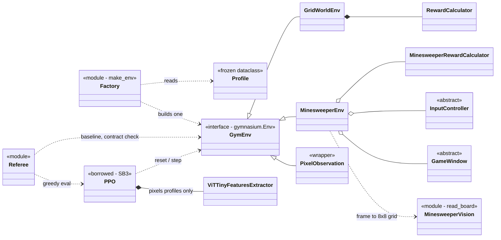

**Read it as:** the factory reads a Profile and builds one Gymnasium env. PPO only ever talks to that env through `reset()`/`step()`, so it never knows which Ground it got. GridWorld *builds* its own reward calculator (composition). MinesweeperEnv is *handed* its hands, window and calculator (aggregation), which is what lets tests pass in fakes.

#### 5.1b Grounds & Link - what PPO can train on

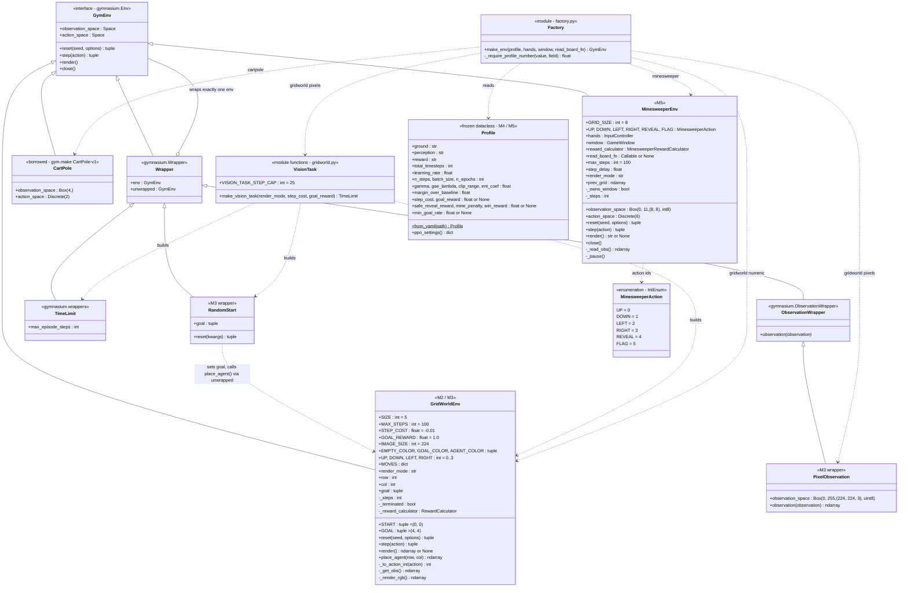

**The design idea to notice:** `Wrapper` both *is* a `GymEnv` (`<|--`) and *holds* one (`o--`). That's the **Decorator pattern**: something that looks exactly like the thing it wraps, so wrappers can stack, e.g. `PixelObservation(TimeLimit(RandomStart(GridWorldEnv())))`. PPO can't tell a wrapped env from a bare one.

`GridWorldEnv`'s reward calculator and `MinesweeperEnv`'s collaborators are shown in 5.1a and 5.1e. `InputController` and `GameWindow` have their own diagrams (5.1d, 5.1c).

#### 5.1c Eyes & Screen - how pixels become an observation

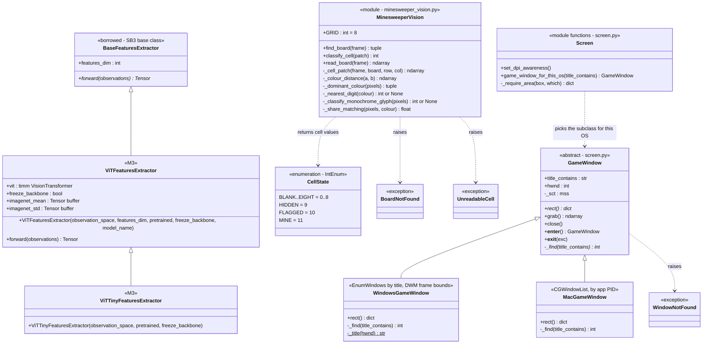

`rect` is an abstract `@property`, not a method you call with `()`. Mermaid has no notation for an abstract property, so it's drawn as `rect()*`. `ViTTinyFeaturesExtractor` only fixes the numbers (`features_dim=192`, `model_name="vit_tiny_patch16_224"`) and hands everything else to its parent.

There are **two separate sets of eyes**, and they never meet. The ViT reads GridWorld pictures for PPO (M3). `read_board` reads LibreMines screenshots into an 8×8 grid (M5). Neither depends on the other.

#### 5.1d Hands - how a decision becomes a keypress

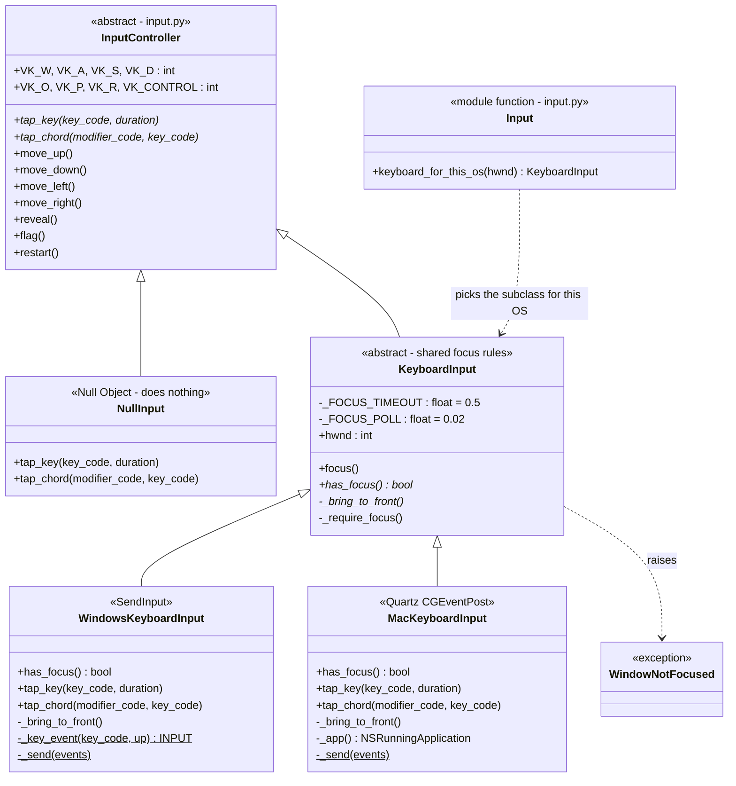

**The design idea to notice:** `KeyboardInput.focus()` is a **Template Method**. The base class writes the algorithm once ("already in front? ask the OS, then poll until it's true or time runs out"), and leaves two steps blank (`has_focus`, `_bring_to_front`) for each OS to fill in. The same idea shows up in `GameWindow`: `grab()` is shared, and `_find`/`rect` are per OS.

On macOS, `hwnd` holds the app's process ID, not a window handle. The name is kept so callers don't need to care, but see `docs/r1/R1_Review.md` item 2.

#### 5.1e Scoring, Referee & Tools - who scores, who judges, who runs things

```mermaid
classDiagram
    class RewardCalculator {
        <<frozen dataclass - GridWorld, M4>>
        +step_cost : float
        +goal_reward : float
        +reward(reached_goal) float
    }
    class MinesweeperRewardCalculator {
        <<frozen dataclass - M5>>
        +safe_reveal_reward : float = 1.0
        +mine_penalty : float = -10.0
        +win_reward : float = 10.0
        +total_safe_cells : int = 54
        +reward(prev_grid, curr_grid) float
        +is_terminated(grid) bool
        +is_win(grid) bool
        +is_loss(grid) bool
        +count_revealed_safe(grid) int
    }
    class CellState {
        <<enumeration - see 5.1c>>
    }

    class Referee {
        <<module - referee.py, R1>>
        +pass_or_fail(ok) str
        +check_contract_shapes(env) tuple
        +measure_random_baseline(make_env_fn, episodes) float
        +evaluate_greedy(model, make_env_fn, episodes) tuple
        +decide_verdict(trained, baseline, margin, shapes_ok, goal_rate, min_goal_rate) tuple
    }
    class Training {
        <<module - training.py, R1>>
        +CLASSIC_PPO_SETTINGS : dict
        +CHECKPOINT_FREQ : int = 5000
        +EVAL_FREQ : int = 2000
        +make_training_callbacks(eval_env, model_dir, log_dir, name_prefix) list
        +best_eval_reward(log_dir) float or None
    }
    class PPO {
        <<borrowed - SB3>>
        +learn(total_timesteps, callback)
        +predict(obs, deterministic) tuple
        +save(path)
        +load(path) PPO$
    }
    class EvalCallback {
        <<borrowed - SB3>>
    }
    class CheckpointCallback {
        <<borrowed - SB3>>
    }
    class GymEnv {
        <<interface - see 5.1b>>
    }

    class CheckHands {
        <<script - check_hands.py, M5>>
        +TARGET_CELL : tuple = (1, 2)
        +TARGET_SEQUENCE : tuple
        +RESET_TRIALS : int = 20
        +collect_measurements(title, step_delay) Measurements
        +decide_keys_live(m) ControlResult
        +decide_null_input(m) ControlResult
        +decide_frozen_frame(m) ControlResult
        +decide_reset(m) ControlResult
        +decide_verdict(m) tuple
    }
    class Measurements {
        <<frozen dataclass - check_hands.py>>
        +target_cell : tuple
        +live_cells_changed : int
        +live_changed_cell : tuple or None
        +live_pixels_changed : int
        +null_cells_changed : int
        +null_pixels_changed : int
        +frozen_obs_cells_changed : int
        +live_obs_cells_changed : int
        +resets_attempted : int
        +resets_clean : int
        +reset_mouse_clicks : int
    }
    class ControlResult {
        <<dataclass - check_hands.py>>
        +number : int
        +name : str
        +passed : bool
        +evidence : list
    }

    class MenuItem {
        <<frozen dataclass - tui.py>>
        +label : str
        +script : str or None
        +message : str
        +note : str or None
        +screen : Callable or None
    }
    class TuiConfig {
        <<frozen dataclass - tui.py>>
        +project_name : str
        +changelog_relpath : str
    }
    class Logger {
        <<unused in production - logger.py>>
        +log_file : str
        +log(message)
        +close()
        +__enter__() Logger
        +__exit__(exc_type, exc_value, traceback)
    }

    MinesweeperRewardCalculator ..> CellState : imports MINE from the eyes module
    Referee ..> GymEnv : reset / step
    Referee ..> PPO : predict(deterministic=True), duck-typed
    Training ..> EvalCallback : builds
    Training ..> CheckpointCallback : builds
    PPO ..> GymEnv : trains on
    CheckHands ..> Measurements : fills
    CheckHands ..> ControlResult : returns four
    CheckHands ..> Referee : pass_or_fail only
    MenuItem ..> TuiConfig : screen(cfg)
```

The two reward calculators share **no** base class or interface: their `reward()` methods take different arguments. That's an honest picture of the code, and `docs/r1/R1_Review.md` item 6 discusses whether it should stay that way. The referee's `model` is **duck-typed**, meaning it accepts anything with a `predict(obs, deterministic=True)` method rather than requiring a PPO object, which is why its tests can use a tiny fake model.

> **Correction - 2026-10-17 (R1 Brick 14, checked line by line against the code).**
> The single §5.1 diagram from Brick 13 had these errors. They're fixed above:
> - **Composition drawn where it was aggregation:** `MinesweeperEnv *-- InputController / GameWindow / MinesweeperRewardCalculator`. All three are passed in from outside.
> - **Wrong parent class:** `GymEnv <|-- ObservationWrapper` skipped `gym.Wrapper`, and `RandomStart` had no parent at all.
> - **Arrows pointing at the wrong thing:** `Factory ..> RandomStart` should go through `make_vision_task()`. `Agent ..> Profile` was wrong too; PPO never sees a Profile, the script reads it.
> - **Missing pieces:** `Measurements` listed 5 of its 11 fields. About 15 members were missing, including `MinesweeperEnv._read_obs()`, `GridWorldEnv._render_rgb()`, `MacKeyboardInput._app()` and `WindowsGameWindow._title()`. `MinesweeperRewardCalculator`'s dependency on `CellState` wasn't drawn, and the TUI classes weren't drawn at all.
> - **Notation errors:** abstract and static markers were written before the return type (`has_focus()* bool`). Mermaid expects them at the end (`has_focus() bool*`).

### 5.2 Code Workflow: The Live Desktop Step (`MinesweeperEnv.step`)

Illustrates the exact method interactions during one environment step against an external desktop game window:

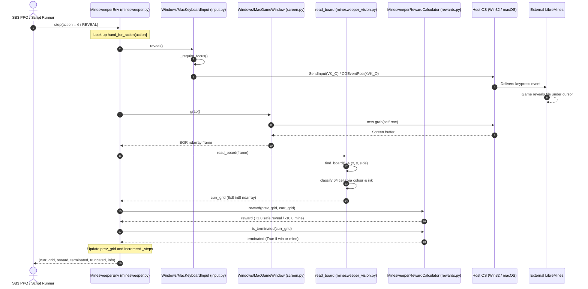

### 5.3 Code Workflow: Universal Profile Factory Instantiation

Shows how declarative YAML configuration becomes a fully composed runtime environment without modifying Python code:

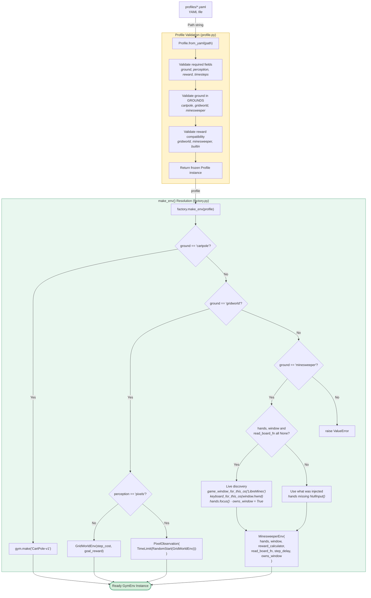

---

## 6. The Milestone Roadmap

```mermaid
flowchart LR
    M0["M0 Setup<br/>done"] --> M1["M1 Borrow the brain<br/>done"] --> M2["M2 Build a ground<br/>done"] --> M3["M3 Add the eyes<br/>done"]
    M3 --> M4["M4 Make it swappable<br/>done"] --> M5["M5 Add the hands<br/>done"] --> R1["R1 Cleanup & OOP<br/>code done"] --> M6["M6 Stardew<br/>next (stretch)"]

    style M0 fill:#d4edda,stroke:#3d9970
    style M1 fill:#d4edda,stroke:#3d9970
    style M2 fill:#d4edda,stroke:#3d9970
    style M3 fill:#d4edda,stroke:#3d9970
    style M4 fill:#d4edda,stroke:#3d9970
    style M5 fill:#d4edda,stroke:#3d9970
    style R1 fill:#e2e3e5,stroke:#6c757d
    style M6 fill:#fff3cd,stroke:#d39e00,stroke-width:3px
```

Each step changes **one thing**: random → learner, borrowed game → our game, numbers → pictures, hard-coded → config, simulated → real window. *Why one thing:* if a result changes, you know the cause.

Numbers for every milestone are in [`RESULTS.md`](RESULTS.md). They're not repeated here, so they can't drift apart.
